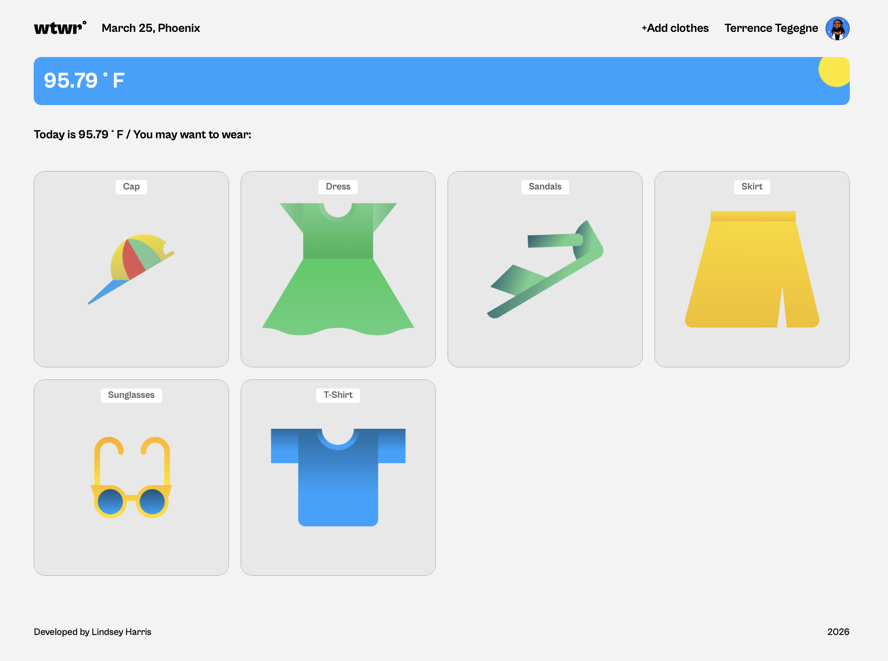
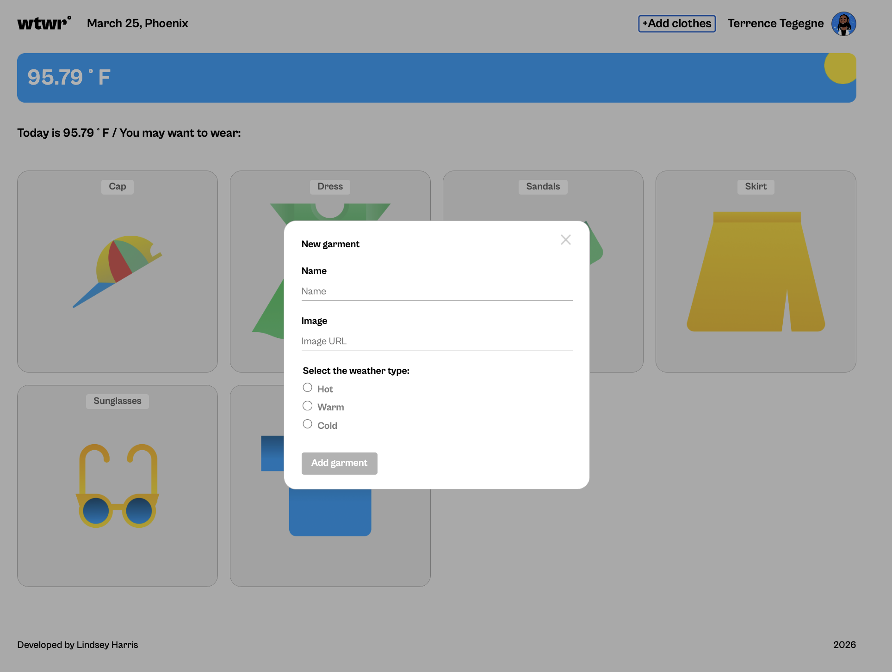
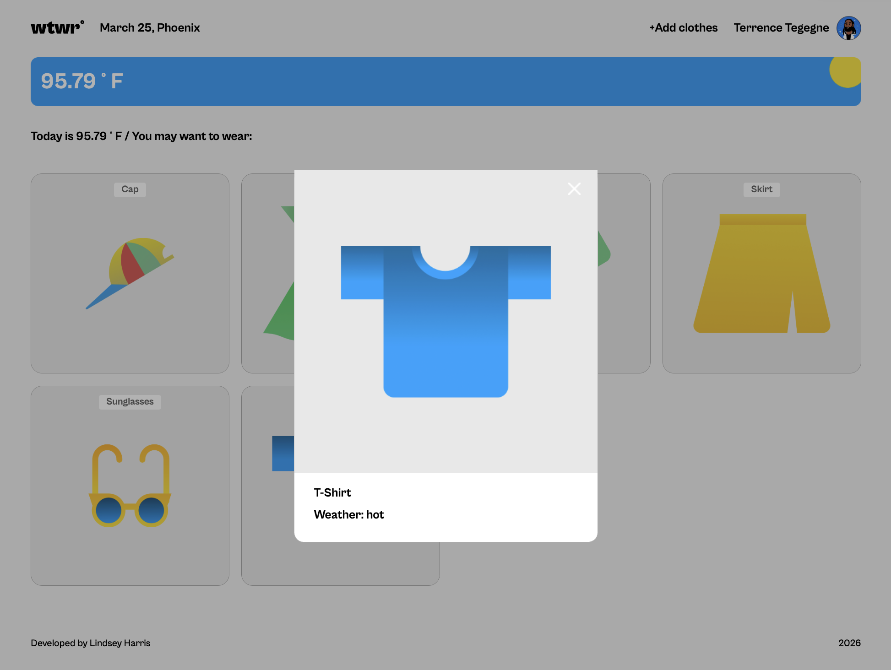
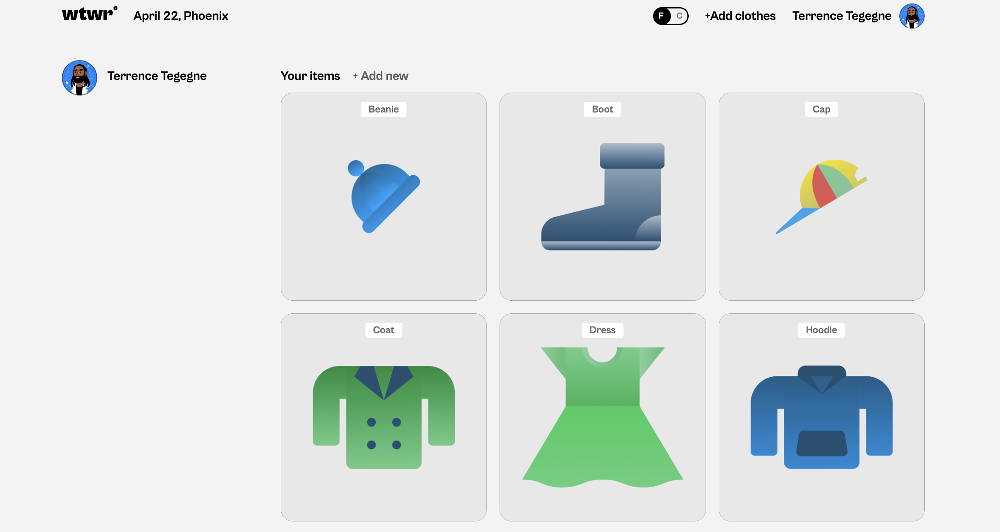

# Project 4: WTWR - Weather App

WTWR stands for "What to Wear." This app uses the weather for a user's location to display the current temperature and suggest clothing based on whether the weather is hot, warm, or cold. Users can also open a clothing preview modal and interact with the app through a clean React interface.

## Features

- 🌤️ Displays the current temperature for the user's location
- 🌡️ Toggles temperature units between Fahrenheit and Celsius
- 👕 Suggests clothing items based on the current weather type
- 🧥 Filters clothing cards by hot, warm, and cold weather
- 🖼️ Opens a clothing item preview modal when a card is selected
- ➕ Allows users to add new clothing items through a controlled form modal
- 🗑️ Allows users to delete clothing items with a confirmation modal
- 👤 Includes a profile page with client-side routing using React Router
- 🔄 Fetches, adds, and deletes clothing items through a mock API using `json-server`
- ⏳ Includes loading states for weather data and item deletion
- 🌙 Uses weather condition and day/night data to update the weather card

## Backend Repository

[View the WTWR backend repository](https://github.com/ln-harris/se_project_express)

## Tech Stack

### Frontend

- JavaScript
- React
- React Router
- Vite
- HTML5
- CSS3
- OpenWeather API

### Development Tools

- Git
- GitHub
- ESLint
- Prettier

## Backend Repository

https://github.com/ln-harris/se_project_express

## Deployment

**🖥️Live Site:** [Open WTWR](https://linwtwr.crabdance.com/)

Express and MongoDB must be running for signup, login, and saved clothing to work. Express handles requests; MongoDB stores accounts, clothing, and likes. Visitors do not need to install anything when these services are hosted.

Production requests use `https://api.linwtwr.crabdance.com`. Hosting the frontend alone does not run the backend or database.

To publish to GitHub Pages, run `npm ci`, `npm run lint`, then `npm run deploy`. In **Settings → Pages**, select the `gh-pages` branch and `/ (root)`. This publishes only the frontend and does not update the Crabdance deployment.

For a local production preview, run `npm run build`, then `npm run preview`, and open the preview URL at `/se_project_react/`.

Images of the site will go here:

**Full Desktop View**  

**Add Clothes Modal**  

**Preview Modal**  

**Profile Modal**  

## Plans for Improvement

- 🔐 Add user authentication and profile management
- 🖌️ Change color of "close" and "like" button on cards
- 🚫 Add visible validation messages to every form so users understand why their input is invalid.
- ❤️ Add a “Liked Items” tab to the profile page where users can view all clothing items they have liked.

## Project Pitch Video

Check out this live recorded demo 🎥 where I describe my
project and some challenges I faced while building it.

- [Pitch Video](https://www.loom.com/share/563e9e809a5f4528bad4bda39f63ca28)
